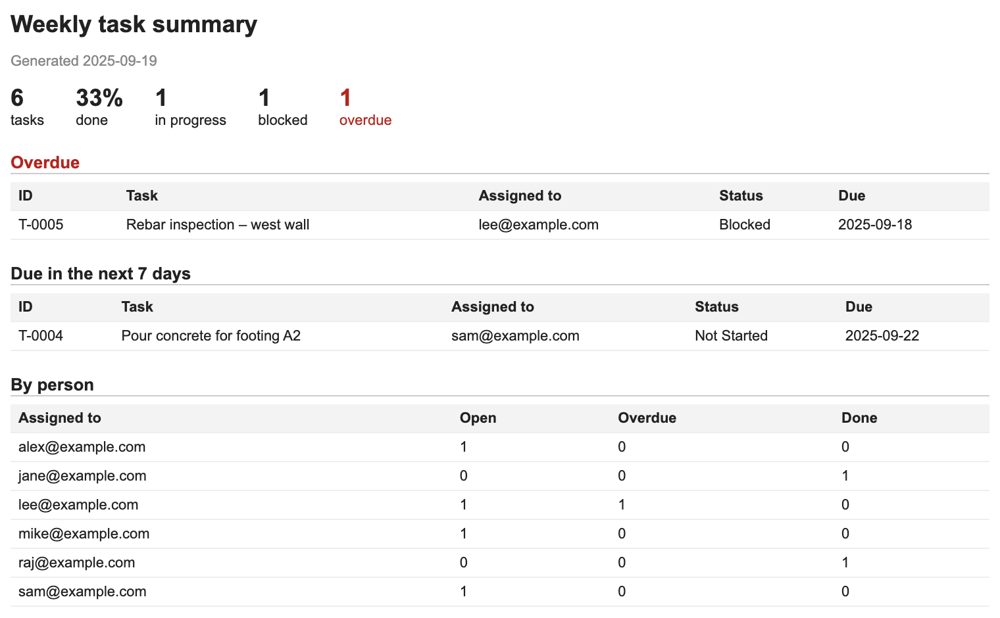

# Sheets Task Tracker Automation

A construction-style task tracker that lives in **Google Sheets** and runs itself with
**Google Apps Script**. Site leads drop CSV files into a Drive folder. The script validates
them, assigns task IDs, applies status updates, keeps an audit trail and emails a weekly PDF
summary every Monday morning.

The core logic is plain JavaScript with no Google dependencies, so it's unit-tested locally
with Node and you can run the whole flow without a Google account (`npm run demo`).

**🔗 Live demo: https://kammy04.github.io/sheets-task-tracker-automation/demo/**. Runs the real tracker logic in your browser, no Google account needed.



## How it works

```
             Drive: "Task Tracker - Inbox"
             ├── tasks_batch1.csv      (new tasks)
             └── updates_batch1.csv    (status changes / notes)
                         │
           every 15 min  ▼   processInbox()
   ┌──────────────────────────────────────────────────────┐
   │ detect file type from headers                         │
   │ normalise headers  ("Assigned To" -> AssignedTo)       │
   │ validate rows      (email, status, date)               │
   │ tasks:   assign T-0001, T-0002 ... skip duplicates     │
   │ updates: change status, append dated note              │
   │ log everything to the Audit tab                        │
   └──────────────────────────────────────────────────────┘
                         │                        file moved to "Processed"
                         ▼
     Sheet "Tasks"  (dropdown validation, overdue rows in red)
                         │
   Mondays 7am           ▼   generateWeeklySummary()
     PDF saved to "Task Tracker - Reports" (+ optional email)
```

## Features

| | |
|---|---|
| **CSV import from Drive** | Time-driven trigger picks up any CSV in the inbox folder, imports it and moves it to *Processed* |
| **Header normalisation** | `Task ID`, `task_id`, `ID` all map to `TaskID`; `Assignee`/`Owner`/`Email` → `AssignedTo`; `Deadline` → `DueDate` |
| **Validation** | Emails must be valid, statuses must map to *Not Started / In Progress / Blocked / Done* (`wip`, `todo`, `complete` are understood), dates accept `2025-09-22` or `9/22/2025` |
| **Stable IDs** | New tasks get the next `T-####` ID, continuing from the highest ID already in the sheet |
| **Duplicate detection** | Same task name + assignee (case-insensitive) is not imported twice |
| **Updates keep history** | Notes are appended with a date stamp, never overwritten |
| **Audit tab** | Every create, update, duplicate, rejection and manual status edit is logged with who and when |
| **Manual edits tracked** | An installable `onEdit` trigger stamps `LastUpdated` and logs status changes |
| **Weekly PDF** | Overdue tasks, tasks due in the next 7 days, and a per-person breakdown, saved to Drive and optionally emailed |
| **Concurrency-safe** | `LockService` prevents two trigger runs importing the same file at once |

## Try it locally (no Google account)

```bash
npm test          # 9 unit tests on the core logic (Node 18+)
npm run demo      # imports the four files in sample-data/ in order and prints the result
```

The demo runs the sample files through the same functions the Apps Script uses:

```
Tasks sheet
│ T-0001 │ Excavate foundation trench       │ jane@example.com │ Done        │ 2025-09-25 │
│ T-0002 │ Install steel beams in section B │ alex@example.com │ In Progress │ 2025-09-28 │
│ T-0003 │ Electrical wiring for floor 2    │ mike@example.com │ Not Started │ 2025-09-30 │
│ T-0004 │ Pour concrete for footing A2     │ sam@example.com  │ Not Started │ 2025-09-22 │
│ T-0005 │ Rebar inspection – west wall     │ lee@example.com  │ Blocked     │ 2025-09-18 │
│ T-0006 │ Order 4" PVC conduits            │ raj@example.com  │ Done        │ 2025-09-20 │

Audit log (excerpt)
│ DUPLICATE │ T-0001 │ row 5 of tasks_batch2.csv                                          │
│ REJECTED  │        │ row 6 of tasks_batch2.csv: AssignedTo "not-an-email" is not an email │
│ REJECTED  │        │ row 7 of tasks_batch2.csv: Status "Someday" is not one of ...       │
│ UPDATED   │ T-0005 │ Status: In Progress -> Blocked; Note added                          │
│ REJECTED  │        │ row 4 of updates_batch2.csv: Unknown TaskID "T-0042"                │
```

`sample-data/tasks_batch2.csv` is deliberately messy (different header spellings, `todo` and
`in progress` statuses, a US-format date, a duplicate, a bad email and an invalid status) to show
what the validation catches.

## Install in Google Sheets

**Option A: copy and paste**
1. Create a new Google Sheet → *Extensions → Apps Script*.
2. Create files `Core.gs` and `Main.gs` and paste in `src/Core.js` and `src/Main.js`.
3. *Project Settings* → tick "Show appsscript.json" and paste in `src/appsscript.json`.
4. Reload the sheet. A **Task Tracker** menu appears.
5. *Task Tracker → Setup*: creates the `Tasks` and `Audit` tabs, the dropdowns, conditional
   formatting and three Drive folders next to the sheet.
6. *Task Tracker → Install automatic triggers*.
7. (Optional) *Project Settings → Script properties*: add `SUMMARY_EMAILS` = `you@company.com`.

**Option B: [clasp](https://github.com/google/clasp)**
```bash
npm i -g @google/clasp && clasp login
cp .clasp.json.example .clasp.json   # paste your script ID
npm run push
```

Then drop the files in `sample-data/` into the *Inbox* folder and run *Import CSVs from Drive inbox*.

### AppSheet front end

The `Tasks` sheet is shaped to work as an AppSheet data source (stable `TaskID` key, one row per
task, enum-friendly status values). See [`docs/appsheet.md`](docs/appsheet.md) for the table, slice
and view setup I used for a mobile CRUD app on top of it.

## CSV formats

**Tasks**: `TaskName`, `AssignedTo`, `Status`, `DueDate` (+ optional `Note`). `TaskID` is ignored and assigned automatically.
**Updates**: `TaskID` plus `Status` and/or `Note`.

The file type is detected from the headers, so file names don't matter.

## Project layout

```
src/
  Core.js          pure logic: parsing, validation, IDs, merge, updates, summary HTML
  Main.js          Sheets/Drive/Mail glue, menu, triggers, audit log
  appsscript.json  manifest (V8 runtime, OAuth scopes)
tests/core.test.js node:test unit tests
scripts/demo.js    local end-to-end run over sample-data/
sample-data/       example task and update CSVs
docs/              AppSheet notes, sample summary output
```

**Tech:** Google Apps Script (V8) · Google Sheets · Google Drive · AppSheet · JavaScript · Node test runner
